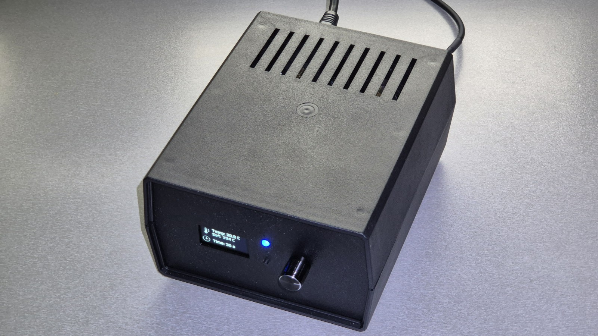

# Electric Wafer Maker Controller (Oblátkovač)

Electric Wafer Maker Controller (Oblátkovač) runs on an Arduino Nano and is built with PlatformIO. It reads a thermistor, accepts input from a rotary encoder, and displays status on an SH1106/SSD1306 monochrome OLED using the U8g2 graphics library.

## Software

The firmware source is in [Software](Software/) folder.

Build with PlatformIO, see `platformio.ini` for board environments.

### ESP32 web interface

The ESP32-C3 firmware serves a responsive Dashboard and a separate Settings page. The dashboard provides live temperature and setpoint, a single state-aware Start/Stop control, bake statistics, and a history chart with actual temperature, setpoint, heater state, and the lid as a digital 0/1 signal. It includes a 15-minute view, a 100-entry activity log held in RAM, and three-column network, appliance, and ESP32 diagnostics. Durations in the web interface are shown in seconds. The page refreshes data over AJAX and supports light, dark, and automatic themes.

Settings includes language selection, DHCP/static IP and device hostname (with a MAC suffix by default), NTP server, timezone, 12/24-hour format, independent Web UI and OTA login switches, restart and reset actions. The firmware exposes `/metrics` for Prometheus and serves the SVG favicon at both `/favicon.svg` and `/favicon.ico`.

The web API uses `GET /api/status`, `/api/history`, and `/api/events` for dashboard data; `/api/events` returns the recent activity log and heater history. State-changing controls use `POST /api/control` with `cmd=RUN` or `cmd=STOP`; bake settings use `POST /api/settings` with `target` and `duration`. Opening `/api/control` in a browser sends GET and returns HTTP 405 because that route changes state only through POST.

From the `Software_ESP32/` directory, build the ESP32-C3 firmware with `pio run -e esp32c3` (or use the OTA environment when uploading over Wi-Fi).

## Bundled libraries

For reproducible builds this repo includes the following libraries under `Software/lib/`:

- `RotaryEncoder-1.5.3` — rotary encoder handling
- `ThermistorLibrary-1.0.6` — thermistor-to-temperature conversion
- `U8g2` — OLED display graphics
- `button-debounce-0.2.1` — simple button debounce helper

See `Software/lib/README` for details about each bundled library.

## Development tips

- If you change pin assignments, update `Software/src/pins.h` and rebuild for your target.
- Use PlatformIO's verbose build (`pio run -v`) to see full compiler/linker output when troubleshooting.
- To add a board environment, edit `platformio.ini` and add matching pin defines in the sketch as needed.

## Hardware

PCB design files are in the [Hardware](Hardware/) folder.

## Enclosure / 3D models

The electronics are housed in a [Z2AW enclosure](https://www.kradex.com.pl/product/enclosures_with_side_panels/z2a?lang=en). 3D-print models are in [3D-models](3D-models/).

## License

Project code is provided as-is. Third-party libraries retain their original licenses — see each library's `LICENSE` file in `Software/lib/`.

## Safety

**Warning:** this project involves mains and high-voltage circuitry. Working on or near high voltage can cause serious injury or death.

- **Disconnect power:** Always remove mains power and verify the circuit is de-energized before touching components.
- **Use PPE:** Wear appropriate personal protective equipment (insulating gloves, eye protection) when testing live systems.
- **Isolation:** Keep a safe distance from exposed conductors; use insulated tools and work on insulated surfaces.
- **Discharge capacitors:** Safely discharge capacitors before servicing; they can hold lethal charge after power removal.
- **One hand rule:** When possible, use the one-hand rule to avoid current passing through the chest.
- **Qualified personnel:** If you are not experienced with mains/high-voltage electronics, seek assistance from a qualified technician or electrician.
- **Work sober and focused:** Never work on high-voltage circuits when tired, impaired, or alone.

Follow local regulations and best practices for electrical safety. The authors are not responsible for damage or injury from misuse.
